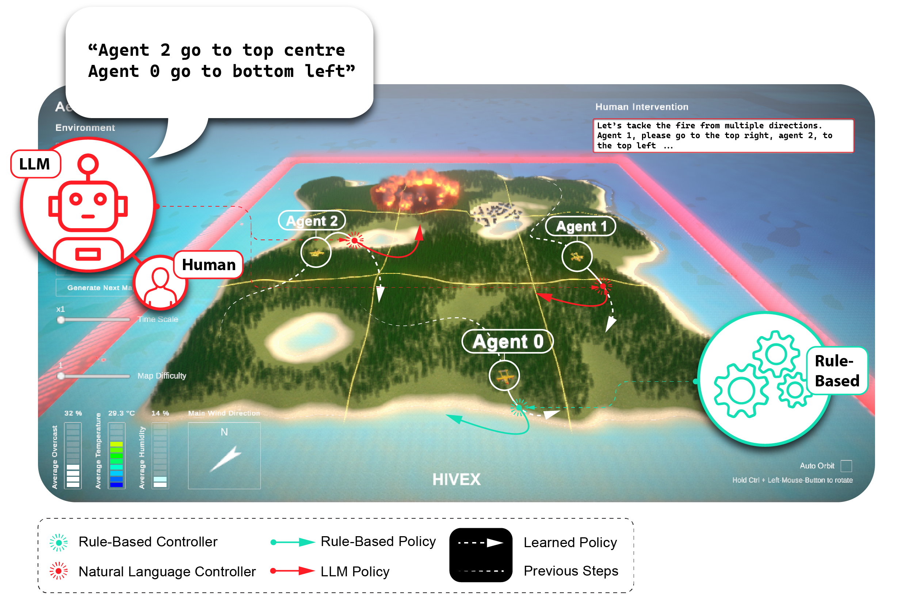

<div align="center">
  
</div>

<br>

# LLM-Mediated Guidance for MARL Systems

_Rule-Based and Natural Language Interventions for Multi-Agent Reinforcement Learning_

## About

The motivation of this work is to demonstrate how LLM and human expert guidance and an LLM-Mediator could be used to guide Reinforcement Learning agents in Multi-Agent Systems to improve training efficiency and performance.

## ⚡ Quick Overview (TL;DR)

- Download Aerial Wildfire Suppression [HIVEX Environments](https://github.com/hivex-research/hivex-environments)
- Reproducing LLM-Mediated Guidance for MARL Systems results: [Train-Pipeline Script](https://github.com/hivex-research/llm_mediated_guidance/blob/main/src/train_pipeline.py)
- [HIVEX Leaderboard](https://huggingface.co/spaces/hivex-research/hivex-leaderboard) on Huggingface 🤗
- [LLM-Mediated Guidance for MARL Systems result plots](https://github.com/hivex-research/hivex-results/tree/master/results/AerialWildfireSuppression/llm_mediated_guidance/plots) on GitHub :octocat:

## 🐍 Installation using uv (Recommended)

This project uses [uv](https://docs.astral.sh/uv/) for dependency management.
`pyproject.toml` and `uv.lock` pin the exact environment the published results
were produced with, including the CUDA build of PyTorch and the `release_20`
tag of `ml-agents-envs`.

1. Install `uv` (once, system-wide):

   ```shell
   # Windows (PowerShell)
   powershell -ExecutionPolicy ByPass -c "irm https://astral.sh/uv/install.ps1 | iex"

   # macOS / Linux
   curl -LsSf https://astral.sh/uv/install.sh | sh
   ```

2. Clone and sync:

   ```shell
   git clone git@github.com:hivex-research/llm_mediated_guidance.git
   cd llm_mediated_guidance
   uv sync
   ```

   That is the whole install. `uv sync` creates `.venv/`, fetches Python 3.9 if
   it is not already present, and installs every locked dependency, including
   `torch==2.4.1+cu124` and `mlagents-envs` built from the `release_20` tag.

3. Provide your LLM API key. The mediator reads it from a `.env` file in the
   repository root:

   ```shell
   echo "DEEPSEEK=your-api-key-here" > .env
   ```

Run anything in the project environment by prefixing it with `uv run`, which
needs no manual activation:

```shell
uv run python src/train_pipeline.py
```

If you would rather activate the environment in the usual way:

```shell
# Windows
.venv\Scripts\activate

# macOS / Linux
source .venv/bin/activate
```

### CPU-only machines

The default lock installs the CUDA 12.4 build of PyTorch. To install the CPU
build instead, point the `pytorch-cu124` index at the CPU wheels in
`pyproject.toml` and re-lock:

```toml
[[tool.uv.index]]
name = "pytorch-cu124"
url = "https://download.pytorch.org/whl/cpu"
explicit = true
```

```shell
uv lock && uv sync
```

### Adding/Updating dependencies

Add or remove packages with `uv`, which updates `pyproject.toml` and `uv.lock`
together:

```shell
uv add <package>
uv remove <package>
```

To refresh the lockfile without changing the declared dependencies:

```shell
uv lock --upgrade
```

Commit `uv.lock` alongside `pyproject.toml` so that collaborators reproduce the
same environment.

> **Note on `numpy`.** `ml-agents` `release_20` declares `numpy==1.21.2`, which
> predates and conflicts with the `ray[rllib]` 2.37 stack. The published results
> were produced with `numpy==2.0.2`, so `pyproject.toml` carries a
> `[tool.uv] override-dependencies` entry that overrides the upstream pin.

## 🌍 Aerial Wildfire Suppression Environment Specs

Observations:

```shell
Visual: (42 x 42 x 3)
Vector: (8)
Position: x
Position: y
Direction: x
Direction: y
Holding water: [True, False]
Closest observed fire location: x
Closest observed fire location: y
Fire state [not_burning, burning]
```

Actions:

```shell
1       Continuous Action (-1 to +1) - this is steering left, steering right
1       Discrete Action branch with two possibilities (0 or 1) - this is dropping water if held
```

Re-Shaped Rewards:

```shell
0       for when fire is extinguished
-100    if crossed red boundary
+1000   for every extinguished burning tree: state change burning -> wet
+0.1    for every tree prepared / used as barrier to block fire from growing: state change existing -> wet
0       for fire too close to village
+0.1    for picking up water
```

## Intervention

## 🧪 Reproducing Paper Results

### Install dependencies:

1. Install dependencies as described in the [🐍 Installation using uv (Recommended)](#-installation-using-uv-recommended) section.

## 🌍 Download HIVEX Environments

### Download / Clone binaries locally

1. Download the HIVEX Aerial Wildfire Suppression environment binaries for your operating system from the [hivex-environments](https://github.com/hivex-research/hivex-environments) repository:

   ```shell
   git clone git@github.com:hivex-research/hivex-environments.git
   ```

2. Please make sure to un-zip the environment folder.

   This is what the environment paths need to look like (windows):

   - `env/Hivex_AerialWildfireSuppression_win/Hivex_AerialWildfireSuppression.exe`

Note: If you want to use a custom directory for your environments and use the `train_pipeline.py`, please adjust the directory global at the top of the script.

### Train using RLLib

Start train pipeline:

```shell
uv run python src/train_pipeline.py
```

### 📊 Results

All results can be found in the [hivex-results](https://github.com/hivex-research/hivex-results/tree/master/results/AerialWildfireSuppression/llm_mediated_guidance/plots) repository. Or on the [HIVEX Leaderboard](https://huggingface.co/spaces/hivex-research/hivex-leaderboard) on Huggingface 🤗. More details on the training runs can be found on [google drive](https://drive.google.com/drive/folders/1WJHPjskP96EnAJz8FI2R-rok1z5XBUW_), which we could not upload due to space constraints.

## ✨ Submit your own Results to the [HIVEX Leaderboard](https://huggingface.co/spaces/hivex-research/hivex-leaderboard) on Huggingface 🤗

1. Install all dependencies as described [above](#-installation-using-uv-recommended).

2. Run the Train Pipeline with `src/train_pipeline.py`

3. Make sure your model matches the [baseline results with task 0 and difficulty 1](https://huggingface.co/hivex-research/hivex-AWS-PPO-baseline-task-0-difficulty-1) model format. :warning: Because the LLM Guidance work has shaped the rewards, please only submit `Crash Count`,
   `Extinguishing Trees`, `Fire Out`, `Fire too Close to City`, `Preparing Trees`, `Water Drop` and `Water Pickup` results.

**Congratulations, you did it 🚀!**

## 📝 Citing [LLM-Mediated Guidance of MARL Systems](https://arxiv.org/abs/2503.13553)

```bibtex
@article{siedler_llm-mediated_2025,
	title = {{LLM}-{Mediated} {Guidance} of {MARL} {Systems}},
	url = {http://arxiv.org/abs/2503.13553},
	doi = {10.48550/arXiv.2503.13553},
	abstract = {In complex multi-agent environments, achieving efficient learning and desirable behaviours is a significant challenge for Multi-Agent Reinforcement Learning (MARL) systems. This work explores the potential of combining MARL with Large Language Model (LLM)-mediated interventions to guide agents toward more desirable behaviours. Specifically, we investigate how LLMs can be used to interpret and facilitate interventions that shape the learning trajectories of multiple agents. We experimented with two types of interventions, referred to as controllers: a Natural Language (NL) Controller and a Rule-Based (RB) Controller. The NL Controller, which uses an LLM to simulate human-like interventions, showed a stronger impact than the RB Controller. Our findings indicate that agents particularly benefit from early interventions, leading to more efficient training and higher performance. Both intervention types outperform the baseline without interventions, highlighting the potential of LLM-mediated guidance to accelerate training and enhance MARL performance in challenging environments.},
	urldate = {2025-09-09},
	publisher = {arXiv},
	author = {Siedler, Philipp D. and Gemp, Ian},
	month = mar,
	year = {2025},
	note = {arXiv:2503.13553 [cs]},
	keywords = {Computer Science - Artificial Intelligence, Computer Science - Computation and Language, Computer Science - Multiagent Systems},
}
```

If you are using hivex in your work, please cite our paper [HIVEX: A High-Impact Environment Suite for Multi-Agent Research (extended version)](https://arxiv.org/pdf/2501.04180):

```bibtex
@article{siedler_hivex_2025,
	title = {{HIVEX}: A High-Impact Environment Suite for Multi-Agent Research (extended version)},
	url = {http://arxiv.org/abs/2501.04180},
	doi = {10.48550/arXiv.2501.04180},
	shorttitle = {{HIVEX}},
	abstract = {Games have been vital test beds for the rapid development of Agent-based research. Remarkable progress has been achieved in the past, but it is unclear if the findings equip for real-world problems. While pressure grows, some of the most critical ecological challenges can find mitigation and prevention solutions through technology and its applications. Most real-world domains include multi-agent scenarios and require machine-machine and human-machine collaboration. Open-source environments have not advanced and are often toy scenarios, too abstract or not suitable for multi-agent research. By mimicking real-world problems and increasing the complexity of environments, we hope to advance state-of-the-art multi-agent research and inspire researchers to work on immediate real-world problems. Here, we present {HIVEX}, an environment suite to benchmark multi-agent research focusing on ecological challenges. {HIVEX} includes the following environments: Wind Farm Control, Wildfire Resource Management, Drone-Based Reforestation, Ocean Plastic Collection, and Aerial Wildfire Suppression. We provide environments, training examples, and baselines for the main and sub-tasks. All trained models resulting from the experiments of this work are hosted on Hugging Face. We also provide a leaderboard on Hugging Face and encourage the community to submit models trained on our environment suite.},
	number = {{arXiv}:2501.04180},
	publisher = {{arXiv}},
	author = {Siedler, Philipp Dominic},
	urldate = {2025-01-22},
	date = {2025-01-21},
	eprinttype = {arxiv},
	eprint = {2501.04180 [cs]},
	keywords = {Computer Science - Artificial Intelligence, Computer Science - Computer Science and Game Theory, Computer Science - Multiagent Systems},
}
```
